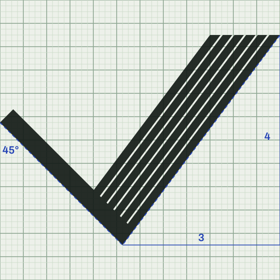

# Vantage brand: the engraved check

Status: v1, 2026-11-25. Companion to `docs/design/direction.md` (Blue Pencil).
Source of truth: `scripts/brand/build_brand.py` generates every SVG in `public/brand/` and the app's monogram path data (`src/lib/brand-mark.ts`). `scripts/brand/render.cjs` renders the PNGs. Don't edit the generated files by hand; change the generator and rerun it.

## 1. Concept

**Money:** the precision of engraved security printing (intaglio linework, guilloché fields, microtext).
**Tech:** an exact construction on a grid, with mathematical curves and nothing drawn freehand.
**The idea:** the V of Vantage is a check mark, the same tick Nova draws in blue pencil on every trade. The monogram is that V-tick, built like an engraved letter. Its main stroke carries **five engraved grooves, one for each pre-flight check** (Reason, Stop, Risk, Target, Size). So the logo is the product's promise: every trade, checked.

The direction proposed in the brief (a V-tick made of guilloché lines on a construction grid) was adopted, with two refinements found in testing:
- **A high-contrast V instead of a striped tick.** A tick drawn as five equal lines read as sporty "speed stripes". A thin 45° hairline plus a thick main stroke in exact 1:3 contrast (the contrast of engraved banknote lettering) reads as an elegant letter first and a check second.
- **Guilloché as a field, not a badge.** A rosette ring around the mark read as a seal, which the legal guardrails rule out. The guilloché is used instead as a cropped, fading engraved field, like the edge of a security-printed page. It never encloses the mark.

## 2. Construction



- **Grid:** 48 × 48 units, with a heavier rule every 4 units.
- **Base point** P0 = (21, 42). The outer silhouette is two exact lines from P0:
  - **hairline arm**, 45° up-left (direction −1, −1), rising 21 units;
  - **main stroke**, on a **3-4-5** slope up-right (direction 3, −4), rising 36 units (a 27 : 36 : 45 triangle).
- **Stroke weights**, measured perpendicular and offset inward from the silhouette: hairline **3.2**, main stroke **9.6** (exactly 1 : 3).
- **Terminals:** the main stroke is cut flat on the cap line (y = 6), like a letter. The hairline ends square to its own direction, like a pen stroke.
- **Engraving:** five grooves, each 0.3 units wide, evenly spaced across the main stroke (at sixths of its width) and parallel to it. They run from the cap line to the inner edge of the hairline, so the silhouette is never cut.
- **Mark extent:** 48 × 36 units, centred in the 48 grid.
- **Wordmark:** "Vantage" in Archivo (variable) at width 125, weight 560, tracking +0.012 em, with the font's kerning plus one hand-kerned pair: V–a tightened by 0.035 em. In the asset files it's outlined to paths (shaped with HarfBuzz); in the app it's set live in the same font with the same settings, with the name taken from `src/lib/brand.ts`.
- **Horizontal lockup:** the mark's visible height = 1.5 × the wordmark cap height, centred on the cap height; gap = 0.6 × cap height.
- **Stacked lockup:** mark height = 2.4 × cap height, centred above the wordmark, with a 0.8 × cap gap.
- **Guilloché field:** evenly pitched concentric rings around a point outside the canvas. Each ring is a pair of interlaced sine lines (phase 0 and π) with a constant wavelength (about 46 px). The field is clipped to its panel and faded with a linear gradient mask. It's generated by `field()` in the generator and never copied from artwork.
- **Microtext** (business card back only): "PRACTICE THE MARKET BEFORE IT COUNTS", 8 px, tracked +0.18 em, one step off the background.

## 3. Versions and files

All files live in `public/brand/`. Absolute paths are listed at the end.

| Asset | File | Use |
|---|---|---|
| Monogram, engraved | `vantage-monogram.svg`, `-inverse.svg`, `-pencil.svg` | Display sizes, 64 px and up |
| Monogram, solid | `vantage-monogram-solid.svg` | Below 64 px |
| Wordmark | `vantage-wordmark.svg`, `-inverse.svg` | Where the mark already appears nearby |
| Horizontal lockup | `vantage-lockup-horizontal.svg`, `-inverse.svg`, `-pencil.svg` | Headers, documents, email signatures |
| Stacked lockup | `vantage-lockup-stacked.svg`, `-inverse.svg`, `-pencil.svg` | Square spaces, title slides |
| Favicon | `favicon.svg` (+ `icon-32.png`) | Browser tabs; solid mark on an ink tile, readable on light and dark tabs |
| App icon | `app-icon.svg`, `app-icon-1024.png`, `icon-512.png`, `icon-192.png`, `apple-touch-icon.png` (180) | Home screens, web manifest (512 also listed as maskable: the mark sits inside the 80% safe zone) |
| Social avatar | `social-avatar.svg/png` (800 × 800) | Profile pictures; safe inside a circle crop |
| Social banner | `social-banner.svg/png` (1500 × 500) | Profile headers; the bottom-left stays clear for the avatar overlap |
| Open Graph | `og.svg/png` (1200 × 630) | The default link preview (wired in `src/app/layout.tsx`) |
| Business card | `business-card-front.svg/png`, `business-card-back.svg/png` (3.5 × 2 in at 300 dpi = 1050 × 600) | Print. Placeholders in [brackets] are filled by the owner. Add 1/8 in bleed at the printer. |
| Construction sheet | `vantage-construction.svg` | This document |

## 4. Colour

The brand uses the product palette. Blue pencil is the only accent.

| Name | Hex | Role in the brand |
|---|---|---|
| Ink | `#141C17` | The mark and wordmark on light grounds |
| Ledger paper | `#EDF1EA` | Light ground |
| Night ledger | `#131C17` | Dark ground (app icon, avatar, card back) |
| Ink on dark | `#E3EAE4` | The mark on dark grounds (inverse files) |
| Blue pencil | `#2443B5` (`#97ACFF` on dark) | Accent version of the mark only. Never the wordmark. |
| Rule green | `#C9D6C5` (field on paper), `#2A3A31` (field on night) | Guilloché fields and microtext only, always one step off the ground |

Contrast: ink on ledger paper 15.2:1. Blue pencil on paper 7.2:1. The paper mark on night ledger is above 14:1.

## 5. Clear space and minimum sizes

- **Clear space:** keep a margin around any lockup of at least **1 × the wordmark cap height**. Around the monogram alone, keep **12 grid units** (a quarter of its 48-unit box) on every side. Nothing else (text, edges, other marks) enters that space.
- **Minimum sizes:**
  - solid monogram: 16 px (on the favicon tile), 20 px on its own;
  - engraved monogram: **64 px** (below that, the grooves blur into a grey stroke, so switch to solid);
  - horizontal lockup: 96 px wide, which keeps the wordmark's cap height at 12 px or more;
  - stacked lockup: 72 px wide;
  - print: lockup 22 mm wide, monogram 5 mm.
- **In the app:** the header uses the solid mark at 28 px with the wordmark set live. Below 360 px viewport width the wordmark is visually hidden but keeps its accessible name ("Vantage home").

## 6. Do and don't

| Do | Don't |
|---|---|
| Use ink on paper, ink-on-dark on night ledger, or the blue-pencil mark with an ink wordmark | Recolour the mark in any other hue, add gradients, glows or shadows |
| Switch to the solid mark below 64 px | Show the engraved grooves at small sizes |
| Keep the 1:3 contrast, the 45° and 3-4-5 angles and the five grooves exactly as generated | Redraw, stretch, rotate, re-space the grooves or change their number |
| Let the guilloché field fade off an edge, behind clear space | Enclose the mark in a ring, rosette, shield or seal |
| Keep engraved effects one step off the ground (rule green) | Print the field in strong contrast, or behind body text |
| Set the wordmark from the outlined file or the live component | Retype it in another font, weight or width, or in capitals |
| Keep "Example", "Simulated" and "Not investment advice" wording on marketing images | Imply real money, returns or endorsements |

## 7. Legal guardrails (binding)

- No imitation of any currency: no portraits, seals, numerals of value, "legal tender", treasury or bank wording, note layouts or serial numbers. The guilloché is generated from parametric curves in the generator. Nothing is traced or copied.
- No other company's marks. The Next.js and Vercel template files were removed from `public/`.
- Social and Open Graph images say "Educational simulator. No real money. Not investment advice." Business cards carry bracketed placeholders until the owner fills them.

## 8. Regenerating

```bash
python3 -m pip install fonttools brotli uharfbuzz     # one time
python3 scripts/brand/build_brand.py                   # SVGs + src/lib/brand-mark.ts
node scripts/brand/render.cjs                          # PNGs (needs Playwright)
```

Fonts are read from `node_modules/@fontsource-variable/{archivo,literata}`, so run `npm install` first.

## 9. Files (absolute paths)

```
/home/user/stockpilot/public/brand/vantage-monogram.svg
/home/user/stockpilot/public/brand/vantage-monogram-inverse.svg
/home/user/stockpilot/public/brand/vantage-monogram-pencil.svg
/home/user/stockpilot/public/brand/vantage-monogram-solid.svg
/home/user/stockpilot/public/brand/vantage-wordmark.svg
/home/user/stockpilot/public/brand/vantage-wordmark-inverse.svg
/home/user/stockpilot/public/brand/vantage-lockup-horizontal.svg
/home/user/stockpilot/public/brand/vantage-lockup-horizontal-inverse.svg
/home/user/stockpilot/public/brand/vantage-lockup-horizontal-pencil.svg
/home/user/stockpilot/public/brand/vantage-lockup-stacked.svg
/home/user/stockpilot/public/brand/vantage-lockup-stacked-inverse.svg
/home/user/stockpilot/public/brand/vantage-lockup-stacked-pencil.svg
/home/user/stockpilot/public/brand/vantage-construction.svg
/home/user/stockpilot/public/brand/favicon.svg
/home/user/stockpilot/public/brand/icon-32.png
/home/user/stockpilot/public/brand/app-icon.svg
/home/user/stockpilot/public/brand/app-icon-1024.png
/home/user/stockpilot/public/brand/icon-512.png
/home/user/stockpilot/public/brand/icon-192.png
/home/user/stockpilot/public/brand/apple-touch-icon.png
/home/user/stockpilot/public/brand/social-avatar.svg
/home/user/stockpilot/public/brand/social-avatar.png
/home/user/stockpilot/public/brand/social-banner.svg
/home/user/stockpilot/public/brand/social-banner.png
/home/user/stockpilot/public/brand/og.svg
/home/user/stockpilot/public/brand/og.png
/home/user/stockpilot/public/brand/business-card-front.svg
/home/user/stockpilot/public/brand/business-card-front.png
/home/user/stockpilot/public/brand/business-card-back.svg
/home/user/stockpilot/public/brand/business-card-back.png
```
